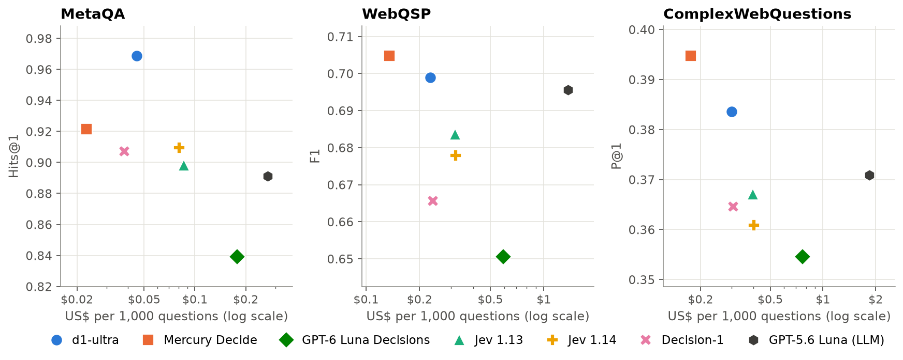

# Deciding where to walk: decision models on knowledge graphs

Many questions about a knowledge graph can be answered by following its connections. To answer "Who directed the
movies that Tom Hanks acted in?", you start at Tom Hanks, follow *acted in* to his movies, follow *directed by* to
their directors, and stop. At each step there is a short list of connections to choose from, and a **decision model**
is built for that kind of choice: you give it numbered options, and it returns a probability for each one. It does not
write any text.

This repository shows how a decision model walks a knowledge graph, and how well it does on three well-known
question-answering benchmarks. It also shows how to use a decision model in Neo4j's GraphRAG library.

**The result in one sentence:** the best decision models answered as accurately as an LLM (GPT-5.6 Luna), or more
accurately, and the LLM cost 6 to 12 times as much. The details are in [benchmark/RESULTS.md](benchmark/RESULTS.md).

## What's inside

| Folder | What it holds |
|-|-|
| [`notebooks/`](notebooks/) | Three notebooks that explain how it works, step by step. Start here. |
| [`benchmark/`](benchmark/) | Notebooks that run the full benchmark with any model on OpenRouter, and [our results](benchmark/RESULTS.md). |
| [`utils/`](utils/) | The code that the notebooks share: loading the graphs, the walk, the models and the scoring. |
| [`data/samples/`](data/samples/) | 200 questions from each benchmark, so everything works without a large download. |

The notebooks:

1. [**How a decision model walks a knowledge graph**](notebooks/1_how_a_decision_model_walks.ipynb). Send one
   decision by hand, compare it with an LLM, walk a whole question on a film graph, and read the decision log.
2. [**Benchmarking decision models**](notebooks/2_benchmarking_decision_models.ipynb). Run 50 benchmark questions with
   a model of your choice, and see how each benchmark scores an answer.
3. [**Answering questions with neo4j-graphrag**](notebooks/3_decision_retriever_in_neo4j_graphrag.ipynb). Use a
   decision model inside Neo4j's GraphRAG library to answer questions on a Neo4j graph, and let an LLM send each
   question to the right retriever.

## Getting started

You need [Docker](https://www.docker.com/), [VS Code](https://code.visualstudio.com/) with the Dev Containers
extension, and an [OpenRouter](https://openrouter.ai/) API key. Running all three notebooks costs a few cents.

1. Clone this repository and open it in VS Code.
2. Copy `.env.example` to `.env`, and put your OpenRouter key in `OPENROUTER_API_KEY`.
3. Choose **Reopen in Container**. The dev container starts Neo4j Community Edition next to the workspace and installs
   everything with [uv](https://docs.astral.sh/uv/).
4. Open `notebooks/1_how_a_decision_model_walks.ipynb`, choose the kernel **Deciding where to walk (uv)**, and run the cells.

The Neo4j Browser is at http://localhost:7474 (user `neo4j`, password `neo4j-password`), so you can look at the
graphs that the notebooks load.

**Without the dev container.** Install uv and run `uv sync`. Start Neo4j yourself, for example with
`docker run -p 7474:7474 -p 7687:7687 -e NEO4J_AUTH=neo4j/neo4j-password neo4j:2026.09.0-community`, and set
`NEO4J_URI=bolt://localhost:7687` in `.env`.

## About neo4j-graphrag

Notebook 3 uses decision models in [neo4j-graphrag](https://github.com/neo4j/neo4j-graphrag-python), Neo4j's Python
library for GraphRAG. We added them in a [pull request](https://github.com/neo4j/neo4j-graphrag-python/pull/728) that
is not merged yet, so `pyproject.toml` installs the pull request's version of the library. Once the pull request is
merged and released, a normal `pip install neo4j-graphrag` will have them.

## Data

The questions and graphs come from these benchmarks. The samples in `data/samples/` are small extracts, and the
benchmark notebooks can download the full sets.

- **MetaQA** (Zhang et al., 2018): film questions over the WikiMovies knowledge base, from
  [camazlucas/MetaQA](https://huggingface.co/datasets/camazlucas/MetaQA) on Hugging Face.
- **WebQSP** (Yih et al., 2016): questions with their official answers from
  [Microsoft Research](https://www.microsoft.com/en-us/download/details.aspx?id=52763).
- **ComplexWebQuestions** (Talmor and Berant, 2018).
- The Freebase graph of each WebQSP and CWQ question comes from the RoG release (Luo et al., 2024):
  [rmanluo/RoG-webqsp](https://huggingface.co/datasets/rmanluo/RoG-webqsp) and
  [rmanluo/RoG-cwq](https://huggingface.co/datasets/rmanluo/RoG-cwq).
