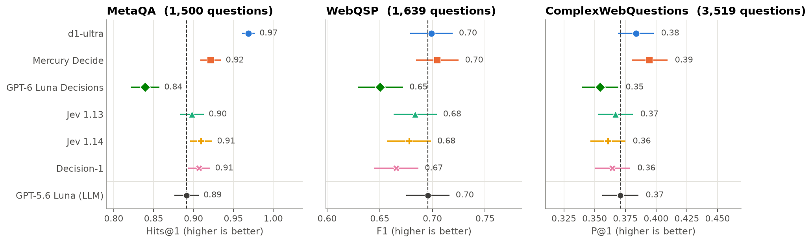
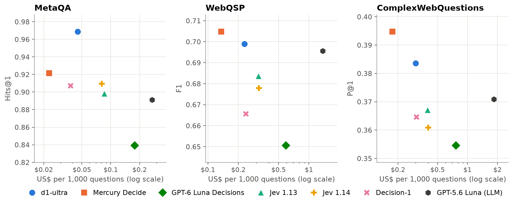

# Benchmark results

Can a small decision model walk a knowledge graph as well as an LLM? On MetaQA, WebQSP and ComplexWebQuestions, the
best decision models answered as accurately as GPT-5.6 Luna, or more accurately, and GPT-5.6 Luna cost 6 to 12 times
as much. On BioHopR's biomedical questions, d1-ultra answered 99% of the questions exactly right, GPT-5.6 Luna 92%,
and GPT-5.6 Luna cost 5.8 times as much.

We gave six decision models and one LLM the same questions. Each model answered by walking a knowledge graph, one
step at a time, and every model saw exactly the same options at every step. This page shows what we found. The
notebooks in this folder run the same benchmark, so you can check our numbers or test your own models.

## The short version

- **Mercury Decide** (Inception) and **d1-ultra** (Liquid AI) were as accurate as GPT-5.6 Luna, or more accurate, on
  all three benchmarks. GPT-5.6 Luna cost about 10 to 12 times as much as Mercury Decide, and about 6 times as much as
  d1-ultra.
- **Jev 1.13** (Typesafe) was about as accurate as GPT-5.6 Luna on all three benchmarks, and GPT-5.6 Luna cost 3 to 5
  times as much.
- **Jev 1.14** (Typesafe) was more accurate than GPT-5.6 Luna on MetaQA and about as accurate on the other two.
  **Decision-1** (Microsoft) was about as accurate on MetaQA and ComplexWebQuestions, and less accurate on WebQSP.
- **GPT-6 Luna Decisions** (OpenAI) was less accurate than GPT-5.6 Luna on all three benchmarks. It was also the most
  expensive of the six decision models.

## What we measured

| Benchmark | The questions | The graph |
|-|-|-|
| MetaQA | Questions about films that need 1, 2 or 3 steps, e.g. "Who directed the movies that Tom Hanks acted in?" We used 1,500 questions, 500 for each number of steps. | One film graph with 43,000 entities |
| WebQSP | Real questions that people typed into a search engine. We used all 1,639 test questions. | A small part of Freebase for each question |
| ComplexWebQuestions (CWQ) | Harder questions built from WebQSP, which need more steps or more conditions. We used its 3,519 development questions. | A small part of Freebase for each question |
| BioHopR | Biomedical questions that need 1 or 2 steps, e.g. "Name all drugs that can treat a disease that is associated with gene/protein ADAMTS12." We used 2,000 questions, 1,000 for each number of steps. | PrimeKG, one biomedical graph with 129,000 entities and 4 million facts |

A walk ends on a set of entities, and each benchmark scores that set in its own way. All scores run from 0 to 1, and
higher is better.

- **Hits@1** (MetaQA): the chance that a random pick from the walk's answer is right.
- **F1** (WebQSP): how well the walk's answer matches the right answers. It is high only when the answer has most of the
  right answers and few wrong ones.
- **P@1** (CWQ): like Hits@1, and an answer also counts when it matches another known name of a right answer.
- **Precision** (BioHopR): the share of the walk's answer that is right, like Hits@1. The right answers are everything
  that the question's relationships reach in PrimeKG; see [BioHopR](#biohopr).
- **Exactly correct**: the share of questions whose answer was fully right.

Notebook 2 in [`notebooks/`](../notebooks/) shows a worked example of each score.

## How accurate each model was

Each dot is a model's score, and its line shows the range that the score would likely fall in if we ran many more
questions (a 95% interval). The dashed line is GPT-5.6 Luna.

<!-- results-tables:start -->
### MetaQA

1,500 questions. The score is Hits@1.

| Model | Maker | Hits@1 | Exactly correct | $ per 1,000 questions | Accuracy compared with GPT-5.6 Luna | GPT-5.6 Luna costs |
|-|-|-|-|-|-|-|
| d1-ultra | Liquid AI | 0.97 | 95% | $0.045 | better | 6.0 times as much |
| Mercury Decide | Inception | 0.92 | 90% | $0.023 | better | 11.8 times as much |
| GPT-6 Luna Decisions | OpenAI | 0.84 | 81% | $0.177 | worse | 1.5 times as much |
| Jev 1.13 | Typesafe | 0.90 | 88% | $0.086 | about the same | 3.1 times as much |
| Jev 1.14 | Typesafe | 0.91 | 89% | $0.081 | better | 3.3 times as much |
| Decision-1 | Microsoft | 0.91 | 87% | $0.038 | about the same | 7.1 times as much |
| GPT-5.6 Luna (LLM) | OpenAI | 0.89 | 88% | $0.270 | (the LLM baseline) |  |

### WebQSP

1,639 questions. The score is F1.

| Model | Maker | F1 | Exactly correct | $ per 1,000 questions | Accuracy compared with GPT-5.6 Luna | GPT-5.6 Luna costs |
|-|-|-|-|-|-|-|
| d1-ultra | Liquid AI | 0.70 | 60% | $0.229 | about the same | 6.0 times as much |
| Mercury Decide | Inception | 0.70 | 61% | $0.135 | about the same | 10.1 times as much |
| GPT-6 Luna Decisions | OpenAI | 0.65 | 56% | $0.590 | worse | 2.3 times as much |
| Jev 1.13 | Typesafe | 0.68 | 58% | $0.318 | about the same | 4.3 times as much |
| Jev 1.14 | Typesafe | 0.68 | 58% | $0.319 | about the same | 4.3 times as much |
| Decision-1 | Microsoft | 0.67 | 57% | $0.237 | worse | 5.7 times as much |
| GPT-5.6 Luna (LLM) | OpenAI | 0.70 | 60% | $1.364 | (the LLM baseline) |  |

### ComplexWebQuestions

3,519 questions. The score is P@1.

| Model | Maker | P@1 | Exactly correct | $ per 1,000 questions | Accuracy compared with GPT-5.6 Luna | GPT-5.6 Luna costs |
|-|-|-|-|-|-|-|
| d1-ultra | Liquid AI | 0.38 | 31% | $0.302 | about the same | 6.1 times as much |
| Mercury Decide | Inception | 0.39 | 32% | $0.175 | better | 10.5 times as much |
| GPT-6 Luna Decisions | OpenAI | 0.35 | 29% | $0.766 | worse | 2.4 times as much |
| Jev 1.13 | Typesafe | 0.37 | 28% | $0.397 | about the same | 4.7 times as much |
| Jev 1.14 | Typesafe | 0.36 | 28% | $0.403 | about the same | 4.6 times as much |
| Decision-1 | Microsoft | 0.36 | 28% | $0.307 | about the same | 6.0 times as much |
| GPT-5.6 Luna (LLM) | OpenAI | 0.37 | 30% | $1.845 | (the LLM baseline) |  |

<!-- results-tables:end -->

On MetaQA, the decision models also answered all 39,093 test questions, and their scores there are within about 0.01
of the scores above.

### BioHopR

BioHopR asks about drugs, genes and proteins, diseases, and side effects or symptoms (phenotypes). For example: "Name
all drugs that can treat a disease that is associated with gene/protein ADAMTS12." The walk starts at the entity that
the question names, and walks PrimeKG, a biomedical knowledge graph. We used 2,000 questions: 1,000 that need one step
and 1,000 that need two. The score is precision. BioHopR is not in the charts on this page, and Mercury Decide is
missing because it was no longer on OpenRouter when we ran BioHopR.

| Model | Maker | Precision | Exactly correct | $ per 1,000 questions | Accuracy compared with GPT-5.6 Luna | GPT-5.6 Luna costs |
|-|-|-|-|-|-|-|
| d1-ultra | Liquid AI | 0.993 | 99.2% | $0.069 | better | 5.8 times as much |
| GPT-6 Luna Decisions | OpenAI | 0.869 | 86.5% | $0.190 | worse | 2.1 times as much |
| Jev 1.13 | Typesafe | 0.922 | 91.6% | $0.108 | about the same | 3.7 times as much |
| Jev 1.14 | Typesafe | 0.941 | 93.6% | $0.108 | about the same | 3.7 times as much |
| Decision-1 | Microsoft | 0.958 | 95.7% | $0.066 | better | 6.0 times as much |
| GPT-5.6 Luna (LLM) | OpenAI | 0.922 | 92.0% | $0.398 | (the LLM baseline) |  |

By the number of steps a question needs:

| Model | 1 step: precision | 1 step: exactly correct | 2 steps: precision | 2 steps: exactly correct |
|-|-|-|-|-|
| d1-ultra | 0.998 | 99.8% | 0.988 | 98.6% |
| GPT-6 Luna Decisions | 0.851 | 84.6% | 0.887 | 88.3% |
| Jev 1.13 | 0.940 | 93.8% | 0.904 | 89.4% |
| Jev 1.14 | 0.966 | 96.5% | 0.915 | 90.7% |
| Decision-1 | 0.972 | 97.2% | 0.944 | 94.2% |
| GPT-5.6 Luna (LLM) | 0.943 | 94.1% | 0.901 | 90.0% |

- **The right answers** are everything that the question's relationships reach in PrimeKG, through every middle entity
  on two-step questions. "Can treat" is PrimeKG's `indication`, "side effects" is `drug_effect`, "phenotypes" is
  `disease_phenotype_positive`, and "associated with" is `drug_protein` or `disease_protein`, depending on the types.
  BioHopR's own answer lists seem to come from an earlier release of PrimeKG: some of their names lack the
  " (disease)" that version 2.1 adds. They are the same as these right answers on 94% of the one-step questions and
  98% of the two-step questions. Against BioHopR's lists, each model's precision is 0.007 to 0.009 lower than in the
  table, and the order of the models is the same.
- **Where the models went wrong.** GPT-5.6 Luna nearly always chose the right first relationship (on 100% of one-step
  and 98.5% of two-step questions). Most of its mistakes came from not stopping: it took more steps than needed on 6.7%
  of one-step questions and 9.5% of two-step questions. GPT-6 Luna Decisions did not stop after one step on 16% of the
  one-step questions. The Jev models chose a wrong first relationship on about 8% of the two-step questions.
- **Without the graph.** The BioHopR paper ([Kim et al., 2025](https://aclanthology.org/2025.findings-acl.668)) asked
  models to answer from memory. The best of them, o3-mini, had a precision of 37.9% on one-step questions and 14.6% on
  two-step questions. We did not run that setup, and the paper matches names in a different way (with an embedding
  model), so these numbers are only context. Our numbers compare models that all walk the same graph.
- **Versions.** PrimeKG 2.1 from [Harvard Dataverse](https://doi.org/10.7910/DVN/IXA7BM), BioHopR at revision
  `08f0669` on Hugging Face, and the same model versions as on the other benchmarks (see the table below).

## Accuracy against cost

Up and to the left is better: more accurate and cheaper. The cost axis is logarithmic, so each step to the right is
several times more expensive. The cost of a question is the cost of every step of its walk, as billed by OpenRouter.

## Compared with the LLM, question by question

Here each decision model is compared with GPT-5.6 Luna on exactly the same questions. A dot to the right of the dashed
line means that the decision model scored higher. The lines are a little wider than usual 95% intervals, because we
compare six models at once and want to avoid a lucky result. We call a model **better** or **worse** only when its whole
line is on one side of zero. Otherwise we call it **about the same**.

## How we ran it

- **The walk.** At each step, the options are the relationships around the entities that the walk stands on: one
  option for each relationship type and direction, plus STOP, which means "these entities are the answer". The model
  picks one option, and the walk follows it to all of its entities. Notebook 1 shows this step by step.
- **The same for every model.** Every model got the same question, the same instructions and the same options, and
  had the same step limit: 4 steps on MetaQA and CWQ, and 3 on WebQSP and BioHopR.
- **Decision models** were called through OpenRouter's decision API. A decision model returns a probability for every
  option, and the walk follows the option that it chose.
- **The LLM**, GPT-5.6 Luna, was called through OpenRouter and answered with a structured answer: a Pydantic model whose
  only field must be one of the option numbers. It did not use reasoning.
- **Unnamed records.** Freebase has records without a name, shown by their ID (such as `m.0j4jq57`), which link other
  entities together. STOP is not offered while the walk stands only on such records, so the walk moves on to the named
  entities behind them. This only happens on WebQSP and CWQ.
- **PrimeKG's facts have no direction**, so on BioHopR there is one option for each relationship type, whichever way
  the fact was stored. After a wrong turn, a walk can stand on thousands of entities. The state then lists only the
  first 1,000 of them; no walk on the other benchmarks stood on more than 861.
- **Scoring** uses each benchmark's own scoring rules and right answers, except on BioHopR (see [BioHopR](#biohopr)).
- **When.** The runs were made in October and November 2026, with these model versions:

| Model | Maker | Name on OpenRouter | Version |
|-|-|-|-|
| d1-ultra | Liquid AI | `liquid/d1-ultra` | `liquid/d1-ultra-20261015` |
| Mercury Decide | Inception | `inception/mercury-decide` | `inception/mercury-decide-20260930` |
| GPT-6 Luna Decisions | OpenAI | `openai/gpt-6-luna-decisions` | `openai/gpt-6-luna-decisions-20261006` |
| Jev 1.13 | Typesafe | `typesafe/jev-1.13` | `typesafe/jev-1.13-20260917` |
| Jev 1.14 | Typesafe | `typesafe/jev-1.14` | `typesafe/jev-1.14-20261014` |
| Decision-1 | Microsoft | `microsoft/microsoft-decision-1` | `microsoft/microsoft-decision-1-20261009` |
| GPT-5.6 Luna (LLM) | OpenAI | `openai/gpt-5.6-luna` | `openai/gpt-5.6-luna` |

The numbers behind this page are in [`results/summary.csv`](results/summary.csv) and
[`results/paired.csv`](results/paired.csv).

## Run it yourself

The three notebooks in this folder run the same benchmark with any model on OpenRouter:

1. [`1_load_benchmark.ipynb`](1_load_benchmark.ipynb) loads the questions and their graphs into Neo4j.
2. [`2_run_benchmark.ipynb`](2_run_benchmark.ipynb) runs decision models and LLMs on them.
3. [`3_compare_results.ipynb`](3_compare_results.ipynb) compares your runs.

The repository comes with 200 questions of each benchmark, so a run takes minutes and costs cents. With 200 questions
the scores are less precise than the ones on this page (their range is about ±0.02 on MetaQA and ±0.06 on WebQSP and
CWQ), and models give slightly different answers from run to run. So expect your numbers to be close to ours, but not
the same.
