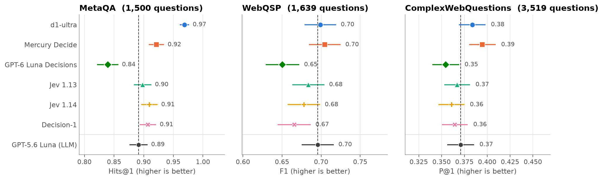
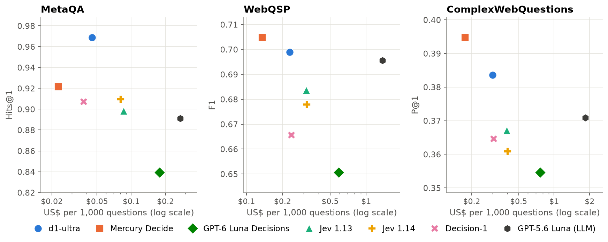
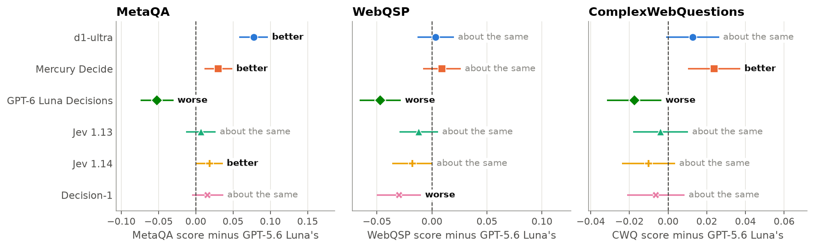

# Benchmark results

Can a small decision model walk a knowledge graph as well as an LLM? On the three benchmarks below, the best decision
models answered as accurately as GPT-5.6 Luna, or more accurately, and GPT-5.6 Luna cost 6 to 12 times as much.

We gave six decision models and one LLM the same questions. Each model answered by walking a knowledge graph, one
step at a time, and every model saw exactly the same options at every step. This page shows what we found. The
notebooks in this folder run the same benchmark, so you can check our numbers or test your own models.

## The short version

- **Mercury Decide** (Inception) and **d1-ultra** (Liquid AI) were as accurate as GPT-5.6 Luna, or more accurate, on
  all three benchmarks. GPT-5.6 Luna cost about 10 to 12 times as much as Mercury Decide, and about 6 times as much as
  d1-ultra.
- **Jev 1.13** (Typesafe) was about as accurate as GPT-5.6 Luna on all three benchmarks, and GPT-5.6 Luna cost 3 to 5
  times as much.
- **Jev 1.14** (Typesafe) was more accurate than GPT-5.6 Luna on MetaQA and about as accurate on the other two.
  **Decision-1** (Microsoft) was about as accurate on MetaQA and ComplexWebQuestions, and less accurate on WebQSP.
- **GPT-6 Luna Decisions** (OpenAI) was less accurate than GPT-5.6 Luna on all three benchmarks. It was also the most
  expensive of the six decision models.

## What we measured

| Benchmark | The questions | The graph |
|-|-|-|
| MetaQA | Questions about films that need 1, 2 or 3 steps, e.g. "Who directed the movies that Tom Hanks acted in?" We used 1,500 questions, 500 for each number of steps. | One film graph with 43,000 entities |
| WebQSP | Real questions that people typed into a search engine. We used all 1,639 test questions. | A small part of Freebase for each question |
| ComplexWebQuestions (CWQ) | Harder questions built from WebQSP, which need more steps or more conditions. We used its 3,519 development questions. | A small part of Freebase for each question |

A walk ends on a set of entities, and each benchmark scores that set in its own way. All scores run from 0 to 1, and
higher is better.

- **Hits@1** (MetaQA): the chance that a random pick from the walk's answer is right.
- **F1** (WebQSP): how well the walk's answer matches the right answers. It is high only when the answer has most of the
  right answers and few wrong ones.
- **P@1** (CWQ): like Hits@1, and an answer also counts when it matches another known name of a right answer.
- **Exactly correct**: the share of questions whose answer was fully right.

Notebook 2 in [`notebooks/`](../notebooks/) shows a worked example of each score.

## How accurate each model was

Each dot is a model's score, and its line shows the range that the score would likely fall in if we ran many more
questions (a 95% interval). The dashed line is GPT-5.6 Luna.

<!-- results-tables:start -->
### MetaQA

1,500 questions. The score is Hits@1.

| Model | Maker | Hits@1 | Exactly correct | $ per 1,000 questions | Accuracy compared with GPT-5.6 Luna | GPT-5.6 Luna costs |
|-|-|-|-|-|-|-|
| d1-ultra | Liquid AI | 0.97 | 95% | $0.045 | better | 6.0 times as much |
| Mercury Decide | Inception | 0.92 | 90% | $0.023 | better | 11.8 times as much |
| GPT-6 Luna Decisions | OpenAI | 0.84 | 81% | $0.177 | worse | 1.5 times as much |
| Jev 1.13 | Typesafe | 0.90 | 88% | $0.086 | about the same | 3.1 times as much |
| Jev 1.14 | Typesafe | 0.91 | 89% | $0.081 | better | 3.3 times as much |
| Decision-1 | Microsoft | 0.91 | 87% | $0.038 | about the same | 7.1 times as much |
| GPT-5.6 Luna (LLM) | OpenAI | 0.89 | 88% | $0.270 | (the LLM baseline) |  |

### WebQSP

1,639 questions. The score is F1.

| Model | Maker | F1 | Exactly correct | $ per 1,000 questions | Accuracy compared with GPT-5.6 Luna | GPT-5.6 Luna costs |
|-|-|-|-|-|-|-|
| d1-ultra | Liquid AI | 0.70 | 60% | $0.229 | about the same | 6.0 times as much |
| Mercury Decide | Inception | 0.70 | 61% | $0.135 | about the same | 10.1 times as much |
| GPT-6 Luna Decisions | OpenAI | 0.65 | 56% | $0.590 | worse | 2.3 times as much |
| Jev 1.13 | Typesafe | 0.68 | 58% | $0.318 | about the same | 4.3 times as much |
| Jev 1.14 | Typesafe | 0.68 | 58% | $0.319 | about the same | 4.3 times as much |
| Decision-1 | Microsoft | 0.67 | 57% | $0.237 | worse | 5.7 times as much |
| GPT-5.6 Luna (LLM) | OpenAI | 0.70 | 60% | $1.364 | (the LLM baseline) |  |

### ComplexWebQuestions

3,519 questions. The score is P@1.

| Model | Maker | P@1 | Exactly correct | $ per 1,000 questions | Accuracy compared with GPT-5.6 Luna | GPT-5.6 Luna costs |
|-|-|-|-|-|-|-|
| d1-ultra | Liquid AI | 0.38 | 31% | $0.302 | about the same | 6.1 times as much |
| Mercury Decide | Inception | 0.39 | 32% | $0.175 | better | 10.5 times as much |
| GPT-6 Luna Decisions | OpenAI | 0.35 | 29% | $0.766 | worse | 2.4 times as much |
| Jev 1.13 | Typesafe | 0.37 | 28% | $0.397 | about the same | 4.7 times as much |
| Jev 1.14 | Typesafe | 0.36 | 28% | $0.403 | about the same | 4.6 times as much |
| Decision-1 | Microsoft | 0.36 | 28% | $0.307 | about the same | 6.0 times as much |
| GPT-5.6 Luna (LLM) | OpenAI | 0.37 | 30% | $1.845 | (the LLM baseline) |  |

<!-- results-tables:end -->

On MetaQA, the decision models also answered all 39,093 test questions, and their scores there are within about 0.01
of the scores above.

## Accuracy against cost

Up and to the left is better: more accurate and cheaper. The cost axis is logarithmic, so each step to the right is
several times more expensive. The cost of a question is the cost of every step of its walk, as billed by OpenRouter.

## Compared with the LLM, question by question

Here each decision model is compared with GPT-5.6 Luna on exactly the same questions. A dot to the right of the dashed
line means that the decision model scored higher. The lines are a little wider than usual 95% intervals, because we
compare six models at once and want to avoid a lucky result. We call a model **better** or **worse** only when its whole
line is on one side of zero. Otherwise we call it **about the same**.

## How we ran it

- **The walk.** At each step, the options are the relationships around the entities that the walk stands on: one
  option for each relationship type and direction, plus STOP, which means "these entities are the answer". The model
  picks one option, and the walk follows it to all of its entities. Notebook 1 shows this step by step.
- **The same for every model.** Every model got the same question, the same instructions and the same options, and
  had the same step limit: 4 steps on MetaQA and CWQ, and 3 on WebQSP.
- **Decision models** were called through OpenRouter's decision API. A decision model returns a probability for every
  option, and the walk follows the option that it chose.
- **The LLM**, GPT-5.6 Luna, was called through OpenRouter and answered with a structured answer: a Pydantic model whose
  only field must be one of the option numbers. It did not use reasoning.
- **Unnamed records.** Freebase has records without a name, shown by their ID (such as `m.0j4jq57`), which link other
  entities together. STOP is not offered while the walk stands only on such records, so the walk moves on to the named
  entities behind them. This only happens on WebQSP and CWQ.
- **Scoring** uses each benchmark's own scoring rules and right answers.
- **When.** The runs were made in October and November 2026, with these model versions:

| Model | Maker | Name on OpenRouter | Version |
|-|-|-|-|
| d1-ultra | Liquid AI | `liquid/d1-ultra` | `liquid/d1-ultra-20261015` |
| Mercury Decide | Inception | `inception/mercury-decide` | `inception/mercury-decide-20260930` |
| GPT-6 Luna Decisions | OpenAI | `openai/gpt-6-luna-decisions` | `openai/gpt-6-luna-decisions-20261006` |
| Jev 1.13 | Typesafe | `typesafe/jev-1.13` | `typesafe/jev-1.13-20260917` |
| Jev 1.14 | Typesafe | `typesafe/jev-1.14` | `typesafe/jev-1.14-20261014` |
| Decision-1 | Microsoft | `microsoft/microsoft-decision-1` | `microsoft/microsoft-decision-1-20261009` |
| GPT-5.6 Luna (LLM) | OpenAI | `openai/gpt-5.6-luna` | `openai/gpt-5.6-luna` |

The numbers behind this page are in [`results/summary.csv`](results/summary.csv) and
[`results/paired.csv`](results/paired.csv).

## Run it yourself

The three notebooks in this folder run the same benchmark with any model on OpenRouter:

1. [`1_load_benchmark.ipynb`](1_load_benchmark.ipynb) loads the questions and their graphs into Neo4j.
2. [`2_run_benchmark.ipynb`](2_run_benchmark.ipynb) runs decision models and LLMs on them.
3. [`3_compare_results.ipynb`](3_compare_results.ipynb) compares your runs.

The repository comes with 200 questions of each benchmark, so a run takes minutes and costs cents. With 200 questions
the scores are less precise than the ones on this page (their range is about ±0.02 on MetaQA and ±0.06 on WebQSP and
CWQ), and models give slightly different answers from run to run. So expect your numbers to be close to ours, but not
the same.
